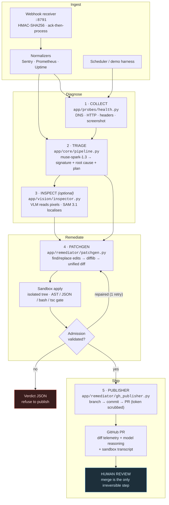

# SentinelPulse — Architecture

**Autonomous, multimodal diagnostics and self-healing agent for web systems.**
Detect → diagnose → *validated* fix → reviewable PR, with a human always in the loop
at the merge boundary.

---

## 1. End-to-end flow



## 2. Sequence — a single incident

```
 Sentry/Prom     Receiver :8791      Pipeline          Patchgen         Sandbox        GitHub
     |                |                 |                 |               |              |
     |-- POST ------> |                 |                 |               |              |
     |                |-- HMAC verify -> 401 on mismatch  |               |              |
     | <-- 202 ack ---|                 |                 |               |              |
     |                |-- normalize --> Incident           |               |              |
     |                |---------------->|                 |               |              |
     |                |                 |-- probes ------>|               |              |
     |                |                 |   DNS/HTTP/shot |               |              |
     |                |                 |<-- signals -----|               |              |
     |                |                 |-- triage (muse-spark-1.3) -->   |              |
     |                |                 |   signature + root cause + plan |              |
     |                |                 |-- author edits ->|              |              |
     |                |                 |                 |-- apply ----->|              |
     |                |                 |                 |               |-- ast/json/  |
     |                |                 |                 |               |   tsc gate --|
     |                |                 |                 |<-- verdict ----|              |
     |                |                 |                 |  (1 repair turn on fail)     |
     |                |                 |<-- unified diff-|               |              |
     |                |                 |-- publish ----->|               |              |
     |                |                 |                 |-- branch+commit+PR --------->|
     |                |                 |                 |   body: diff telemetry,      |
     |                |                 |                 |   model reasoning, sandbox   |
     |                |                 |                 |   transcript                 |
```

**Invariants the diagram encodes**

- The webhook **acks before it processes** — a slow diagnosis must never make the
  sender retry and duplicate a ticket.
- The sandbox is the **only** place a patch is applied. Production is untouched by
  design; the PR is the hand-off.
- Nothing is published unless the admission gate returned `validated`. The
  publisher independently re-checks for zero-file / missing-tree diffs.
- Every irreversible action (merge) is a human click.

## 3. Components

| Stage | Path | Responsibility | Failure mode it owns |
|---|---|---|---|
| Receiver | `app/webhook/receiver.py` | HMAC-guarded intake, ack-then-process | Bad signature → 401, malformed JSON → 400, receiver survives both |
| Normalizers | `app/webhook/normalizers.py` | Sentry / Prometheus / Uptime → one `Incident` | Unknown shape → explicit reject, never a silent partial |
| Probes | `app/probes/health.py` | DNS, HTTP, hardening headers, screenshot | Network fault measured, not assumed |
| Triage | `app/core/pipeline.py` | Error-signature classification, root cause, plan | Reasoning-token exhaustion surfaced as `truncated_by_reasoning` |
| Vision | `app/vision/inspector.py` | Rendered-page defects text scrapers miss | VLM cannot hand-write diffs; localisation delegated to SAM 3.1 |
| Patchgen | `app/remediator/patchgen.py` | find/replace → `difflib` unified diff → sandbox validate | Convergence: one repair turn, then refuse |
| Admission | `patchgen._post_apply` | AST (`.py`) · JSON (`.json`) · bash (`-n`) · tsc (`.ts/.tsx`) | Syntax fails **closed**, never publishes broken code |
| Publisher | `app/remediator/gh_publisher.py` | branch → commit → PR, token scrubbed from logs | Auth via `x-access-token`; URL secrets regex-scrubbed |

## 4. Admission gate — the two-tier TypeScript policy

The gate must never be the reason a latency-sensitive run stalls, so full
type-checking is **opt-in and off the default path**:

```
DEFAULT  (no env set)
  tsc --noEmit <file>
  ├── TS1xxx syntax family  ──> BLOCK            (fails closed)
  └── TS2xxx+ type family   ──> tolerate + log   ("first-type: TS2322 ...")

OPT-IN  SENTINEL_TS_TYPECHECK=1  AND  SENTINEL_TS_LAYER=<cached node_modules root>
  tsc -p <generated tsconfig>   paths: {"*": ["<layer>/*"]}
  ├── TS1xxx syntax family  ──> BLOCK
  └── TS2xxx+ type family   ──> BLOCK

DEGRADED  SENTINEL_TS_TYPECHECK=1 but no resolvable layer
  └── falls back to DEFAULT and logs "(typecheck requested, no layer ... degraded)"
```

Why the layer exists: a bare sandbox clone has no `node_modules`, so `import react`
fails with `TS2307` — a *type* error that has nothing to do with the patch. The
cached layer is built once per target repo and reused across jobs by mapping
`paths."*"` at it, which is what makes strict mode meaningful without paying
`npm ci` per job. The generated tsconfig lives beside the sandbox file and is
deleted in the `finally` block.

Measured: **13/13** gate checks (`tests/test_ts_gate.py`, offline — no network,
no API key, no `npm ci`).

## 5. Why the diff is built, not written

`muse-spark-1.3` repeatedly emitted hunks with invented offsets and context lines
missing their leading space, which `patch` rejects. The remediator therefore asks
the model for **exact find/replace edits** and lets `difflib` assemble the unified
diff — correct by construction, with a single repair turn if the sandbox rejects
the result. Same reasoning applies to long files: instead of a blind `[:8000]`
slice (which silently hid a defect at line ~302 of a 12.4k-char file), excerpts are
windowed (`WINDOW_LINES=70`, `MAX_WINDOWS=5`) around matched regions.

## 6. Verification surface

| Check | Command | Result |
|---|---|---|
| End-to-end drill (webhook → PR) | `.venv/bin/python demos/demo4_e2e_pipeline.py` | 32/32, ~33.7s |
| Pipeline regression | `.venv/bin/python tests/test_pipeline.py` | 19/19 |
| TypeScript admission | `.venv/bin/python tests/test_ts_gate.py` | 13/13 |

Offline suites make **no network calls**. `META_MODEL_API_KEY` and `GITHUB_TOKEN`
are read from the environment (or `~/.hermes/scripts/env-key.sh`) and never logged.